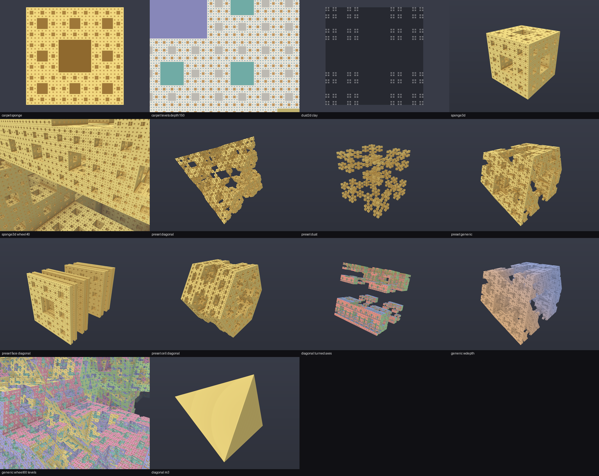

# Hypersponge

A small desktop explorer for one fractal family in three modes: the Sierpinski carpet (2D), the
Menger sponge (3D) and the 4D Menger sponge seen through a moving 3D slice. All three zoom
without limit.

**Status: design phase.** There is no program yet. This repository holds the design and a
verified prototype of the maths, the shaders and the camera rules. The program will be built in
four stages, one pull request each.



These stills come from the prototype: the real fragment shaders on a software OpenGL renderer,
driven by the prototype camera. Top row: the carpet, the carpet at depth 3^-150, Cantor dust,
the Menger sponge. The rest are the 3D sponge from inside and slices of the 4D sponge.

## What is here

| Path | Content |
| --- | --- |
| [`docs/design-notes.md`](docs/design-notes.md) | The full design: the maths, rendering, camera and controls, interface, code layout, test plan, stages, and reference sections for whoever writes the code |
| [`prototype/`](prototype/README.md) | Reference code (numpy and GLSL) and seven check scripts. Everything the design claims as verified is checked here |

## The idea in short

- One rule defines every shape. A point of the unit cube is removed at level k when at least m
  of its coordinates lie in the middle third at that level. With m = 2 this gives the carpet in
  2D, the Menger sponge in 3D and its analogue in 4D.
- A position is stored as base-3 digits, so zoom has no limit. Each frame the CPU builds a short
  table of nearby walls relative to the camera, and a float32 shader does the rest.
- 3D and 4D use distance-estimator ray marching. 4D is shown as a 3D slice that can be turned
  into the fourth direction and slid along it.

## Plan

1. Skeleton, core and the 2D carpet.
2. The 3D sponge.
3. The 4D slice.
4. Extras, picked after stage 3.

Section 19 of the design notes holds a brief for each stage.

## Run the prototype checks

Needs [uv](https://docs.astral.sh/uv/). The shader check needs any OpenGL 3.3; on Linux without
a GPU, Mesa llvmpipe under `xvfb-run` is enough.

```
cd prototype
./run_all.sh
```

## Planned stack

Python 3.12, uv, numpy, moderngl, Dear ImGui (imgui-bundle), OpenGL 3.3. Windows first. The
same stack as [mandelscope](https://github.com/bartsikorski/mandelscope), without its deep-zoom
machinery.

## Licence

MIT, see [LICENSE](LICENSE).
