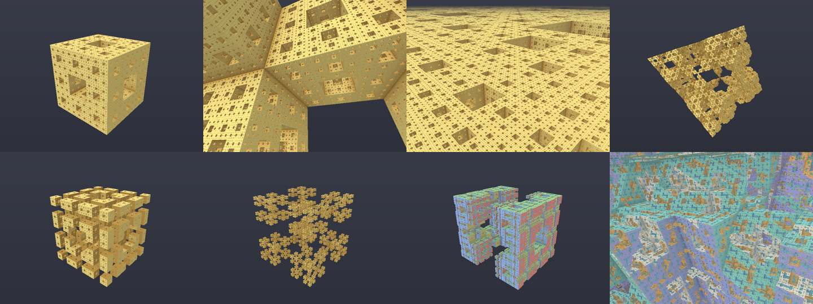
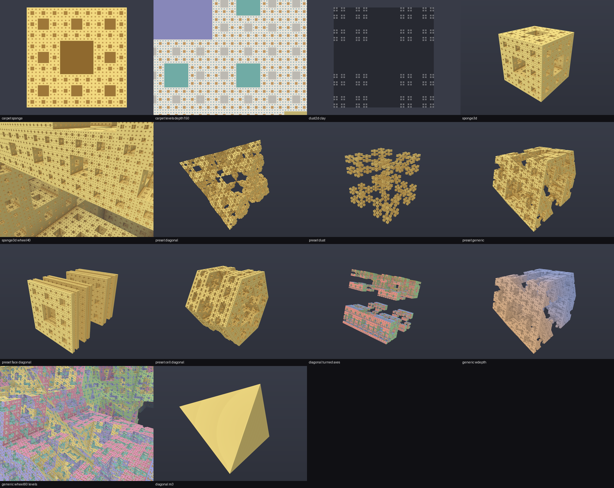

# Hypersponge design

This file is a copy of the project's design document as it stood on 14 November 2026. Keep it current in every pull request that changes the design.

## 1. Summary

Hypersponge is a small desktop explorer for one fractal family in three modes: the Sierpinski carpet (2D), the Menger sponge (3D) and the 4D Menger sponge seen as a moving 3D slice. All three modes zoom without limit and share one core: a position stored as base-3 digits, a per-frame table of nearby walls, and a float32 shader.

The decisions below come from the [briefing](https://claude.ai/artifact/V4XvDH4wVtX3hhfXWPgwSq) and Bart's reply on 12 November 2026.

| Decision | Choice |
| --- | --- |
| D1 Object | The "m-rule" family, Menger rule (m=2) by default, m selectable |
| D2 4D view | Ray-marched 3D slice, plus a small inset map of the tesseract and the slice |
| D3 4D controls | Mouse and keys act on the slice; a modifier turns the slice into the 4th direction |
| D4 Stack | Same as mandelscope: Python 3.12, uv, moderngl, Dear ImGui (imgui-bundle), Windows first |
| D5 Repository | A new repository, `bartsikorski/hypersponge`, created by Bart on 14 November 2026 |
| D6 Name | Hypersponge, a working name |
| 3D view | The plain 3D sponge stays as its own mode next to 2D and 4D |
| D7 3D renderer | Distance-estimator ray marching |
| D8 Zoom | Unlimited |
| D9 Styles | Level colours, axis colours, clay, w-depth (4D), and a yellow "sponge" material |
| D10 Shape options | The m slider only. The click-to-edit grid of kept pieces is left for later |
| D11 Testing | Full: exact-arithmetic ground truth, shader-versus-CPU checks, image tests, fuzzing, scripted GUI session, CI |
| D12 Staging | Four stages, one pull request each |

The repository now exists. Section 11 lists what the detail pass of 14 November 2026 added and changed, sections 12 to 19 are reference material for the coding threads, and the few points still open for Bart are at the end of section 10.

## 2. The fractal family

One rule defines every shape in the program. The object lives in the unit cube \[0,1\]^n, with n = 2, 3 or 4.

- **Digit.** For a coordinate x and a level k = 1, 2, 3, ... the digit is `floor(x * 3^k) mod 3`. Digit 1 means "x is in the middle third at level k".
- **Removed region R\_k.** A point is in R\_k when at least m of its n coordinates have digit 1 at level k. R\_k is defined for all of space and repeats with period 3^(1-k).
- **The set.** S = the unit cube minus the union of all R\_k. The level-L approximation S\_L removes only R\_1 ... R\_L.

| n | m | Kept cells per level | Dimension | Name in the interface |
| --- | --- | --- | --- | --- |
| 2 | 2 | 8 of 9 | 1.893 | Sierpinski carpet |
| 2 | 1 | 4 of 9 | 1.262 | Cantor dust |
| 3 | 2 | 20 of 27 | 2.727 | Menger sponge |
| 3 | 3 | 26 of 27 | 2.966 | Centre removed |
| 3 | 1 | 8 of 27 | 1.893 | Cantor dust |
| 4 | 2 | 48 of 81 | 3.524 | 4D Menger sponge |
| 4 | 3 | 72 of 81 | 3.893 | Denser 4D sponge |
| 4 | 4 | 80 of 81 | 3.989 | Centre removed |
| 4 | 1 | 16 of 81 | 2.524 | Cantor dust |

The kept count is the sum over j < m of C(n, j) \* 2^(n-j), and the dimension is log(kept) / log(3). Both are test values.

Two facts about this family shape the design.

- **Lower dimensions are facets.** With one coordinate fixed at 0, that coordinate never has digit 1, so the 4D set restricted to w = 0 is exactly the 3D set, and the 3D set at z = 0 is the carpet. The 3D mode is therefore the 4D renderer with one axis switched off.
- **All faces are axis-aligned.** Every surface is a piece of a wall "coordinate i = constant". Normals are exact and need no finite differences.

The user-facing shape settings are: mode (2D, 3D, 4D), rule m (1 to n, default 2), and max level (1 to 12, or unlimited, default unlimited).

## 3. Core maths

The three hard parts are solved and verified by a prototype: the distance estimator, unlimited zoom in float32, and a cost that does not grow with depth. The prototype is in the repository under `prototype/` and is the starting code for `hypersponge/core` and the shaders. Section 11 lists what the second round of prototyping added.

### 3.1 Distance estimator

For a point p and level k, let a\_i be the signed distance from coordinate i to the nearest "middle third" slab of level k (negative inside the slab). Sort the n values. Then p is inside R\_k exactly when the m-th smallest value a\_(m) is negative, and -a\_(m) is a lower bound on the distance to leave R\_k.

```
DE(p) = max( boxDistance(p),  max over levels k of  -a_(m)(p, k) )
```

DE is at most 0 inside the solid S\_L and positive in empty space. It is a lower bound on the true distance, because S is contained in the cube and in the complement of every R\_k, and the distance to an intersection is at least the distance to each part. For m = 2, n = 3 this is the well-known Menger formula of Inigo Quilez; the m-th smallest value generalises it to every rule and dimension.

Skipping fine levels only makes DE smaller, so level of detail (section 4) can never make a ray overshoot.

### 3.2 Position as base-3 digits

A position is stored per axis as `x = (O + f) * 3^-E`.

- `O` is a Python integer of any size and sign: the index of the level-E cell.
- `f` is a float64 in \[0, 1): the place inside that cell.
- `E` is the unit exponent. One "local unit" is 3^-E.

`move(d)` adds a local vector and carries into `O`. `rescale(+1)` multiplies the unit by 1/3 (f = 3f, carry a digit into O); `rescale(-1)` does the reverse. Neither changes the position.

### 3.3 Camera-relative level table

The shader never sees absolute coordinates. Once per frame the CPU builds a table with one row per relevant level. A row holds, for each axis, the two walls of the middle third that surrounds the camera, measured from the camera in local units, plus the slab width w.

```
level k <= E (coarse), exact integers:
    p  = 3^(E-k)                    # slab width in local units
    P  = O // (3p)                  # floor division
    lo = (3P + 1) * p - O - f
    hi = lo + p                     # computed as an integer before subtracting f
level k > E (fine), float64:
    s  = 3^(k-1-E);  w = 1 / (3s);  P = floor(f * s)
    lo = (3P + 1) * w - f;  hi = (3P + 2) * w - f
```

Because `lo` and `hi` are computed exactly and only then converted to float32, a wall next to the camera is exact however deep the camera is, and a far wall has the same relative precision as everything else at that distance. Values beyond 1e30 are clamped to 1e30.

The table also carries the outer cube's faces (`boxLo`, `boxHi`, camera-relative), the absolute level number of each row (for colours), and a mask of switched-off axes.

Three rules keep the table short.

1. **Far limit.** A level matters only at points inside R\_k. A coarse level is dropped when R\_k is further from the camera than the view distance `far`.
2. **Fine limit.** Rows stop when the slab width falls below 0.3 times the pixel footprint at the camera's own clearance, or at the max level setting.
3. **Cap.** At most 64 rows. If more are active, the coarsest are dropped and a counter is shown in the status bar. This did not occur in any test with a normalised unit.

### 3.4 Choosing the unit

After every camera move, E is changed so that the camera's own DE, evaluated on the CPU over all levels down to E + 26, lies in \[1, 3) local units. E never goes below 0. In 2D the rule is instead that the view height lies in \[1, 3) local units.

A result of 0 or less means the camera is inside solid. The motion rule in section 5 prevents that; if it happens anyway, the camera reverts to its last good state.

### 3.5 The shader's estimator

```glsl
vec4 wallDist(vec4 q, int i) {            // q: point relative to the camera, local units
    float w = uW[i];
    vec4 u = q - uLo[i];
    vec4 a = max(uLo[i] - q, q - uHi[i]);          // exact near the camera
    vec4 v = mod(u + w, 3.0 * w) - w;              // other periods, for far points
    a = mix(a, max(-v, v - w), greaterThan(abs(u - 0.5 * w), vec4(1.5 * w)));
    return mix(a, vec4(BIG), uOff);                // switched-off axes never count
}
float de(vec4 q, float lodcut) {
    vec4 b; float d = boxDist(q, b);
    for (int i = 0; i < uCount; i++) {
        if (uW[i] < lodcut) break;                 // rows are sorted widest first
        d = max(d, -sort4(wallDist(q, i))[uM - 1]);
    }
    return d;
}
```

The full file is `prototype/shaders/common.glsl`. `deInfo` is the same loop and also returns which row and which axis set the maximum.

### 3.6 What the prototype measured

| Check | Result |
| --- | --- |
| DE against brute-force distance, 10 rule and dimension cases, 3,000 points each | Never above the true distance; median ratio 0.97 to 1.00, worst 0.57 |
| float32 table against exact rationals, depths 3^0 to 3^-200, including a camera 1e-9 units from a huge wall | Worst relative error 1.5e-7. Correction of 14 November: the first run compared depths 3^0 to 3^-20 only, because a row-count guard skipped the deeper cases without saying so. With the faster table, 31 cases at 3^-60 and 3^-200 are compared as well |
| Same world position at unit E and E + 2 | Same DE within float32 rounding |
| Table with far limit 1,000 units against the full table, for points within the limit | Identical; 8 to 15 rows at every depth tested, down to 3^-322 |
| Wheel-zoom rule applied 80 times (3D and 4D oblique slice) | Reached depth 3^-88 with 12 to 17 rows |
| `march.glsl` on Mesa llvmpipe against the numpy marcher, 5 scenes, every pixel | Hit, level and axis agree on 100% of pixels; depth within 7e-7 relative on 99% of pixels, none above 1e-3 |
| Rays | 10 to 27 steps per ray on average; 320x240 in 11 to 38 ms on 4 CPU cores |
| 1,500 random 4D moves under the motion rule | Never inside solid; depth wandered between 3^-45 and 3^-77 |
| Added 14 November. Fast level table against the straightforward one: 1,584 positions in 2D, 3D and 4D, every rule, depths to 3^-300, beside walls, inside holes, outside the cube | Identical rows. About 1 ms per table down to depth 3^-1000, 1.3 ms at 3^-3000, 5 ms at 3^-10000; the first version took 14 ms at 3^-1000 |
| Added 14 November. carpet.frag on llvmpipe against exact base-3 membership, 8 views down to depth 3^-300, including m = 1, a level cap and the edge of a large hole | 0 of 10,972 sampled pixels differ in every view; GLSL equals numpy on 100% of pixels |
| Added 14 November. march.frag colours against the numpy shading, 5 scenes covering all 5 styles | Mean difference 1.6e-8 to 4.1e-6; no pixel off by more than 0.02; hit, row and axis agree on 100% of pixels |
| Added 14 November. Camera rules: 9,000 random inputs over every control in 3D and 4D, from the overview and after dives of 30 and 150 wheel notches | Never inside solid; at most 21 table rows; the eye never beyond 30 units; in overview the slice always meets the cube; 0.8 to 1.2 ms per input |
| Added 14 November. 5,000 overview rotations, jogs and rolls; 100,000 frame rotations; the 4D Menger preset against 3D mode | rho and h unchanged (drift 4e-15); frame stays orthonormal; the Menger preset equals 3D mode on every ray |
| Added 14 November. 2D camera: 2,600 wheel events at random cursor positions to depth 3^-408; the anchor rule over 1,967 wheel events each for the carpet and for dust | At most 9 table rows; aiming at visible material never ended inside a hole down to 3^-400; the anchor shift stayed under a quarter of a pixel; 0.3 ms per event |

### 3.7 Sample images from the prototype

The first picture was rendered on the CPU by the reference code, with the same estimator, level of detail and sponge colours the program will use. The 4D pictures are single frames; in the program the slice moves.



The slice at w = 0.12 breaks into blocks because 0.12 has digit 1 at level 2, where only corner pieces survive. At w = 1/2 every digit is 1 and the slice is Cantor dust. At any w whose digits are only 0 and 2 the slice is the plain Menger sponge.

The second picture, added on 14 November, comes from the real shaders: `carpet.frag` and `march.frag` on Mesa llvmpipe, driven by the prototype camera, 8 jittered samples per pixel. Top row: the carpet in the Sponge style, the carpet at depth 3^-150 in Levels, Cantor dust in Clay, the 3D overview. Second row: the 3D sponge after 40 wheel notches, then the 4D presets Diagonal, Dust and Generic. Third row: the presets Face diagonal and Cell diagonal, the diagonal slice turned with Shift-drag in the Axes style, the Generic slice in W-depth. Bottom row: the Generic slice after 60 wheel notches in Levels, and the diagonal slice of the denser rule m = 3.



## 4. Rendering

There are two fragment shaders on OpenGL 3.3 core: `carpet.frag` for 2D and `march.frag` for 3D and 4D. Both read the same level table as uniforms (`uCount`, `uLo[64]`, `uHi[64]`, `uW[64]`, `uLevelNo[64]`, `uBoxLo`, `uBoxHi`, `uOff`, `uM`). No compute shaders and no float64 are used.

### 4.1 Frame pipeline

1. Camera update, unit choice and level table on the CPU (section 3). Skip when nothing changed.
2. Draw one full-screen triangle into an RGBA16F target at the current render scale.
3. When the view is unchanged, later frames add jittered samples into an accumulation target (up to 16) for anti-aliasing.
4. Blit to the window with tone mapping (gamma 2.2), then draw the ImGui panel, inset and status bar.

### 4.2 2D shader

Each pixel takes a 3x3 grid of samples. A sample at camera-relative point q walks the rows widest first, stops at rows narrower than one third of a pixel, and is "removed at row i" when `sort4(wallDist(q, i))[uM - 1] < 0`. Samples outside the unit square are background. The pixel colour is the average of its samples.

The table for 2D uses `far` = 0.55 times the view diagonal and a fine limit of one third of a pixel. Two rules added on 14 November make deep 2D zoom work in practice: the anchor rule and the cover rule (section 15.1). For m = 1 the detail cut is 2 pixels, so that the dust stays visible (section 14.4).

### 4.3 3D and 4D ray marcher

The camera has a frame F of four orthonormal object-space vectors: right, up, forward and ana (the slice normal). A pixel with camera-space direction dc marches along `D = F * vec4(dc, 0)`, starting at the camera.

```
t = 0
repeat up to uMaxSteps (default 300):
    foot = t * uPix                    # size of one pixel at distance t
    d = de(D * t, foot)                # rows narrower than a pixel are skipped
    if d < 0.5 * foot: hit; stop
    t += d
    if t > uFar: miss; stop
running out of steps counts as a hit
```

3D mode is the same shader with the fourth axis switched off (`uOff.w = 1`) and ana unused.

At a hit, `deInfo` gives the row and the axis that formed the surface. The object-space normal is that axis, signed to face the ray. Its projection onto the slice, normalised, is the shading normal. If the projection is shorter than 1e-4, the normal faces the camera.

### 4.4 Light, occlusion, fog

- **Light.** One key light fixed to the camera, up and to the left: `diffuse = 0.5 + 0.5 * dot(n, L)` with L = normalize(-0.45, 0.65, -0.62) in camera space. It works deep inside tunnels where a sun would not reach.
- **Ambient occlusion.** Five taps along the in-slice normal at distances 1.5 \* foot \* 3^j, j = 0..4, each evaluated with the hit's level of detail: `occ = mean(clamp((h - de) / h, 0, 1))`, `ao = 1 - 0.95 * occ`. The factor 3 matches the fractal's own scale steps.
- **View distance and fog.** The scene scale sigma is the distance to the surface under the screen centre, found by the CPU (section 5.1) and smoothed with a 0.25 s time constant. `uFar = viewRange * sigma`, with viewRange 40 by default (slider 10 to 300). Fog blends to the background with `1 - exp(-(3t / uFar)^2)` and reaches it fully at uFar. This gives depth cues and is also the far limit that keeps the table short.
- **Shadows** are not in the first version.

### 4.5 Styles

| Style | Surface colour | Modes |
| --- | --- | --- |
| Sponge (default) | Yellow foam, see below | 2D, 3D, 4D |
| Levels | Palette indexed by absolute level number mod 8; choice of 3 palettes | 2D, 3D, 4D |
| Axes | By the face's axis: x red, y green, z blue, w gold | 3D, 4D |
| Clay | Light grey | 2D, 3D, 4D |
| W-depth | Diverging blue to orange by the hit point's w: across the whole cube in overview, relative to the eye when immersed (section 17.2) | 4D |

All styles share the light, occlusion and fog above. Extra settings: background (dark or light), fog on or off, occlusion strength, and in 2D only an "inverted" switch that swaps holes and material.

**Sponge material.** Base colour (0.97, 0.80, 0.26), cavity colour (0.45, 0.22, 0.03). `colour = mix(cavity, base, ao^2) * (0.16 + 0.92 * diffuse^1.5)`. In 2D: material in the base colour, holes shaded by their size on screen from a mid orange (smallest) to a dark brown (largest), on the background colour outside the square (section 17.3). A per-cell brightness variation was dropped from the first version and is now a stage 4 item.

### 4.6 Speed

The prototype needs 10 to 27 estimator calls per ray and 8 to 17 table rows, at any depth. I expect that to run at full 1080p resolution on an RTX 5060 Ti, but it is not measured on that card yet, so the plan includes two safeguards.

- **Dynamic resolution.** Measure GPU time per frame. Above 14 ms, multiply the render scale by 0.85 (floor 0.35). Below 9 ms, multiply by 1.1 (ceiling 1.0). While the view is still, render at scale 1.0 and accumulate.
- **Long-frame guard.** If a frame at scale 0.35 still takes over 100 ms, split the draw into horizontal bands with scissor rectangles, a few per frame. This keeps Windows from resetting the driver on a weak GPU.
- **Quality setting.** One slider scales the level-of-detail cut (0.5 to 2 pixels) and the step limit (150 to 600).

## 5. Camera and controls

The camera code is pure Python with no OpenGL, so every rule here is unit-tested without a GPU.

### 5.1 Shared rules

- **State.** 2D: a centre position and a view height. 3D and 4D: an eye position and an orthonormal frame F = (right, up, forward, ana), kept as a float64 matrix and re-orthonormalised every frame. Field of view 50 degrees.
- **Free distance.** `free(u)` marches one ray from the eye along the unit vector u with the picture's level of detail and returns the distance to the first surface. The prototype's pure-Python version takes about 0.7 ms per ray.
- **Motion rule.** Every translation along u by a requested step s becomes `min(s, 0.5 * free(u))`. The camera can approach a surface for ever and can never enter solid. Then the unit is chosen again (section 3.4).
- **Scene scale sigma.** `free(forward)`, smoothed. If the centre ray misses, sigma grows towards the distance to the centre, at most doubling per update. It always stays between the clearance and 3^8 times the clearance. Sigma sets key speeds, fog and view distance. It is not the camera's clearance, because in 4D a wall can be very close in the hidden direction while the visible scene is far away.
- **Regimes.** Let c be the cube's centre, R = sqrt(n) / 2 its bounding radius, and rho the eye's distance from c measured inside the slice (in 3D, the plain distance). The camera is in **overview** when rho >= 1.05 R, otherwise **immersed**. Rotations pivot on c in overview and on the eye when immersed. Both are safe: a pivot on c keeps rho, and a pivot on the eye does not move the eye.
- **Reset** (Home) returns to the overview start: eye at slice coordinates (1.45, 1.05, -1.75) from c, looking at c. In 4D it returns to the last preset chosen.

### 5.2 Controls

| Input | 2D | 3D and 4D |
| --- | --- | --- |
| Left-drag | Pan | Overview: turn the object about its centre. Immersed: look around. The scene follows the mouse in both |
| Wheel | Zoom by 1.25 per notch, keeping the point under the cursor | Move 20% of the way to the surface under the cursor; wheel back undoes it. With nothing under the cursor it moves towards the point of that ray nearest the centre and stops there |
| Right-drag | Pan | Slide sideways and up or down so the point under the cursor follows the mouse |
| W S A D, R F | Pan (W S A D) | Fly forward, back, left, right, up, down at 1.0 sigma per second; Shift is 4 times faster |
| Q E | none | Roll |
| Home | Reset | Reset |
| Shift + left-drag | none | 4D only. Turn the slice: horizontal drag rotates in the (right, ana) plane, vertical in (up, ana) |
| Shift + wheel, or comma and period | none | 4D only. Slide the slice along ana by min(8% of sigma, 0.5 \* free(ana)) per notch |
| 1 2, 3 4, 5 6 | none | 4D only. Rotate in (right, ana), (up, ana), (forward, ana), 45 degrees per second |
| Tab, F1, M, F11, F12 | Hide panel, help, inset map, full screen, save a PNG | same |

All rotations are Givens rotations applied in the camera's own frame: `F = F * G`. In overview the eye also moves, `eye = c + F G F^T (eye - c)`, which leaves the eye's coordinates in the camera frame unchanged.

### 5.3 Why these 4D controls

The 3D slice is an ordinary 3D world, so the ordinary 3D controls keep working in it. The fourth dimension adds three rotation planes and one translation, and each gets one modifier or key pair. In overview the object stays centred while its cross-section morphs, like the classic rotating tesseract. Immersed, turning the slice works like turning your head into the hidden direction: nearby things change slowly and far things sweep past.

### 5.4 Presets, sliders and automatic motion (4D)

- **Presets** set ana and a slice offset h = (eye - c) . ana, then place the eye at the overview start. Menger (ana = w, w = 1/4), Dust (ana = w, w = 1/2), Diagonal (1,1,1,1), Face diagonal (0,0,1,1), Cell diagonal (0,1,1,1), Generic (1,2,3,4); all but the first two pass through the centre.
- **Offset slider** in overview: h from -H to +H with H = 0.5 \* (|ana\_x| + |ana\_y| + |ana\_z| + |ana\_w|), the range over which the slice meets the cube. It moves the eye along ana, which is safe because rho does not change.
- **Plane jogs.** Six drag fields (xy, xz, yz, xw, yw, zw) rotate about the pivot in object axes. They are relative controls that spring back to zero, because six absolute angles would fight the mouse.
- **Auto slide** moves the slice back and forth: across the full range in overview (8 s each way), and by sigma-scaled steps when immersed, reversing when blocked.
- **Auto turn** rotates at 10 degrees per second in a chosen plane.

The w = 1/4 preset is exactly the Menger sponge at every depth, because 1/4 = 0.0202... in base 3 never has digit 1. The w = 1/2 preset is exactly Cantor dust, because every digit is 1.

## 6. Interface

The window is the fractal, with one collapsible panel on the left, an inset map bottom right and a one-line status bar. There are no saved spots, keyframes or video features.

### 6.1 Panel

| Group | Controls |
| --- | --- |
| Mode | 2D carpet, 3D sponge, 4D sponge. Each mode keeps its own camera, so switching back returns to where you were |
| Shape | Rule m (1 to n, with the name from section 2); Max level (1 to 12, unlimited) |
| Style | Style list; palette (Levels only); background; fog; occlusion strength; inverted (2D only); quality |
| View | Reset; field of view (30 to 90 degrees); view distance |
| 4D slice (4D only) | Presets; offset slider; six plane jogs; auto slide; auto turn with plane choice; read-out of ana as four numbers and of h |
| Help | Opens the controls table from section 5.2 |

### 6.2 Status bar

Mode and rule name, depth as "3^-E (about 10^-x)", regime (overview or immersed), frames per second, render scale, table rows in use, and a warning when rows were dropped.

### 6.3 Inset map

A 200 pixel square drawn with the ImGui draw list from points computed in numpy. It can be hidden with M.

- **2D.** The unit square and the view rectangle. When the rectangle is under 3 pixels it becomes a dot.
- **3D.** A wireframe cube in a fixed oblique projection, the eye as a dot and a short arrow for the view direction.
- **4D.** A wireframe tesseract (16 corners, 32 edges) in a fixed oblique projection with the four axes drawn in the axis colours and labelled x, y, z, w. The slice is drawn as the line segments where the hyperplane cuts each of the 24 square faces; together they outline the cross-section polyhedron. The eye is a dot with a view arrow.

The map answers "which way is the slice tilted and where am I" at overview scale. Deep inside, the eye dot stays put and the status bar's depth figure carries the rest.

### 6.4 Start-up

The program opens in 3D mode with the Sponge style, in overview. A first-run hint line under the status bar names the three basic actions: drag to turn, wheel to zoom, F1 for help.

## 7. Code layout and stack

The stack is mandelscope's, minus everything deep-zoom specific: Python 3.12 managed by uv, numpy, moderngl with glcontext, imgui-bundle (hello\_imgui on GLFW), pillow, and pytest with ruff for development. OpenGL 3.3 core is enough. There is no gmpy2, no ffmpeg and no worker process.

```
hypersponge/                      repository root
  pyproject.toml  uv.lock  .python-version  README.md  CHANGELOG.md  LICENSE
  run.bat  setup_windows.ps1      same pattern as mandelscope
  .github/workflows/ci.yml        Ubuntu, Mesa llvmpipe, xvfb, as in mandelscope
  docs/design-notes.md            this design, kept current
  hypersponge/
    __main__.py  cli.py           gui (default), render, info, bench
    core/                         no OpenGL imports
      rule.py                     Rule(n, m, max_level), names, kept-cell count
      position.py                 Pos: digits, move, rescale, exact()
      levels.py                   Table, level_table(), normalize()
      sdf.py                      exact ground truth, de_table (numpy), de_scalar,
                                  free_distance, march (numpy)
      frame.py                    Givens rotations, orthonormalise, look-at,
                                  slice basis, presets
      camera.py                   Camera2D, CameraND: regimes, motion rule, wheel,
                                  drag, turn, slide, auto motion
    render/
      context.py                  window and headless contexts
      shaders/                    common.glsl, march.frag, carpet.frag, blit.frag
      renderer.py                 uniforms, targets, dynamic resolution,
                                  accumulation, render_still()
      styles.py                   style list, palettes, material constants
    ui/
      app.py                      hello_imgui runner, input to camera, frame loop
      panel.py  inset.py  help.py
      selftest.py                 scripted GUI session
  tests/
```

Rules for the code:

- `core/` must import without OpenGL and without imgui. All geometry decisions live there.
- `common.glsl` is included by both fragment shaders and by a test-only probe shader, so tests exercise the same GLSL the program runs.
- `hypersponge render --mode 4d --preset diagonal --size 1280x720 -o out.png` renders a still without a window. Tests and README images use it.
- Patterns to copy from mandelscope: `cli.make_headless_context`, the `hello_imgui.RunnerParams` set-up with a `custom_background` callback at the end of `app.py`, `tests/conftest.py`, the `--selftest` scripted session, and `.github/workflows/ci.yml`. Nothing is imported from mandelscope.
- Licence MIT, as mandelscope.

## 8. Test plan

Ground truth is exact rational arithmetic on base-3 digits, the same role MPFR plays in mandelscope. Tests run on every pull request on Ubuntu with Mesa llvmpipe and xvfb. Markers: `gpu` (needs OpenGL 3.3), `gui` (needs a display), `slow`.

| File | Layer | What it checks |
| --- | --- | --- |
| `test_rule.py` | Maths | Kept-cell counts by enumeration against the formula for all 9 rules; self-similarity (a point of a kept cell at level L+1 equals its image at level L); invariance under axis permutation and x to 1-x; the 4D set at w = 0 equals the 3D set, and 3D at z = 0 equals the carpet |
| `test_sdf.py` | Maths | For 10 rule and dimension cases: DE <= 0 exactly on the solid; DE <= brute-force distance; 1-Lipschitz; median DE / true distance >= 0.9. Scalar, numpy and exact versions agree |
| `test_position.py` | Maths | move then inverse move; rescale up and down; negative cells; all against `exact()` |
| `test_levels.py` | Maths | float32 table DE against exact rationals at depths 0, 1, 5, 20, 60, 200 for random, all-ones, Cantor and near-wall positions (tolerance 2e-5 relative); rebase invariance; far-limit pruning equals the full table inside the limit; row count <= 24 after normalize; the fast table equals the straightforward one row for row; cap behaviour |
| test\_camera2d.py | Logic | Zoom keeps the point under the cursor within half a pixel; zoom in then out returns within 2 pixels; the anchor rule never ends inside a hole over 1,900 wheel events to depth 3^-400 for m = 1 and m = 2; the cover rule keeps the table at 12 rows or fewer; the centre stays in the square |
| `test_camera.py` | Logic | Frames stay orthonormal after 100,000 random rotations; rotations in overview keep rho and h; 10,000 random moves in 3D and 4D never enter solid and never raise; wheel in then out returns within 1%; regime switching; preset values; offset slider range |
| `test_shader.py` | GPU | Probe shader: GLSL `de` and `deInfo` at 20,000 points against `de_table` (float32), max difference 1e-5 relative. Depth image of `march.frag` against the numpy marcher on 6 scenes: hit and level agree on over 99.5% of pixels |
| `test_carpet.py` | GPU | 2D image against a CPU rasteriser using exact membership, 8 views from full square to depth 3^-150: under 0.5% of pixels differ |
| `test_images.py` | GPU | Golden images, 256x256, for 14 scenes covering every style, mode and preset: mean absolute difference under 2/255. Same camera at unit E and E+1: under 1/255. Deep-zoom identity: a view at depth 60 whose coarse digits are all 0 or 2 equals the view at depth 12 with the same last digits |
| `test_render_cli.py` | GPU | `hypersponge render` writes the right size for each mode; no NaN or all-one-colour frames at depths 0, 30, 300 |
| `test_gui.py` | GUI | Scripted session: each mode, drag, wheel, keys, every style, every preset, auto slide and turn, panel hide, help, screenshot per step, no OpenGL errors, no exception, final report JSON |
| `hypersponge bench` | Manual | Frame time for 8 fixed scenes at 1080p and 4K on the real GPU; printed, not asserted. Run on the RTX 5060 Ti at the end of stages 2 and 3 |

The prototype contains working versions of nearly every check in this table; `prototype/README.md` lists them. The stages turn them into pytest files.

Each stage also ends with a human check: Bart runs the build on his PC and looks at it.

## 9. Stages and task briefs

The work is four stages in order, one thread and one pull request each, and each ends with something Bart can run. Every thread starts from `docs/design-notes.md` and `prototype/` in the repository. Section 19 holds a ready brief for each stage.

**Before stage 1.** Done on 14 November 2026: the repository `bartsikorski/hypersponge` exists, and its main branch holds the design notes and the prototype.

### Stage 1: skeleton, core and the 2D carpet

- **Build.** Repository scaffolding from section 7 (pyproject, uv lock, run.bat, setup script, CI). All of `core/` except the 3D and 4D camera, ported from `prototype/sponge_ref.py` with the function names of section 7. `carpet.frag`, `blit.frag`, the renderer with accumulation, `Camera2D`, the app window with the Mode, Shape, Style and View groups, status bar, 2D inset map, help, F12 screenshot. Styles Sponge, Levels and Clay, and the inverted switch. `hypersponge render` and `info`.
- **Tests.** `test_rule`, `test_sdf`, `test_position`, `test_levels`, `test_carpet`, the 2D part of `test_images` and `test_gui`.
- **Done when.** CI is green. Wheel zoom reaches depth 3^-300 with a stable picture and no slowdown. Rule m = 1 and m = 2 and max levels 1 to 12 all draw correctly. Bart has run it on Windows.

### Stage 2: the 3D sponge

- **Build.** `common.glsl` and `march.frag` from `prototype/shaders/`, with shading, occlusion, fog and the styles of section 4, including Axes. `frame.py`, `CameraND` for n = 3 with both regimes, the motion rule, wheel, drags, fly keys and roll. Scene scale sigma. Dynamic resolution and the long-frame guard. 3D inset map. `hypersponge bench`.
- **Tests.** `test_camera` (3D parts), `test_shader`, 3D scenes in `test_images`, `test_render_cli`, 3D steps in `test_gui`.
- **Done when.** CI is green. Starting from the overview, the wheel alone can fly into a hole and on to depth 3^-100 without the camera entering solid. Bench numbers from the RTX 5060 Ti are recorded in the design notes, and the 1080p overview holds 60 frames per second or the notes say why not.

### Stage 3: the 4D slice

- **Build.** Fourth axis switched on in the table and shader (already supported by both). `CameraND` for n = 4: slice turns, slide along ana, pivot rule, presets, offset slider, plane jogs, auto slide and auto turn. W-depth style. The 4D inset map. The 4D slice panel group and ana and h read-outs.
- **Tests.** 4D parts of `test_camera`, `test_shader` and `test_images` (every preset, including that the w = 1/4 preset matches the 3D render within 1/255), 4D steps in `test_gui`.
- **Done when.** CI is green. Every preset shows the expected shape. Auto slide runs through the whole object in overview without flicker. A 4D zoom to depth 3^-100 works on an oblique slice. Bart has tried the controls and said which feel wrong.

### Stage 4: extras, picked after stage 3

These are independent, and Bart chooses which are worth doing once he has used the 4D mode.

- Inverted style in 3D and 4D at a finite level (the removed pieces shown as solids).
- The grid editor for kept pieces (D10's other option), which adds shapes such as the Vicsek cross.
- A projection mode in the inset or main view showing level 1 and 2 as a wireframe.
- Sun light with soft shadows.
- Orbit about the point under the cursor when immersed.
- The simplex family (triangle, tetrahedron, pentatope).
- Windows packaging and a Windows CI job, as in mandelscope.

* Added 14 November: a per-cell brightness variation for the sponge material.
* Added 14 November: saving the settings between runs.

### Notes for every thread

- Keep `docs/design-notes.md` and `CHANGELOG.md` current in the same pull request.
- Do not change the maths of section 3 without re-running the prototype checks; a faster variant must pass the same tests.
- Anything in this document that turns out wrong in practice is reported back to Bart with a proposed change, not silently replaced.

## 10. Risks and open points

The three risks named in the briefing are closed by the prototype. The rest have a planned answer and a test.

| Risk | Answer | State |
| --- | --- | --- |
| A distance estimator for every rule in 4D | The m-th smallest wall distance (3.1) | Verified against brute force |
| Oblique slices are not self-similar, so 4D zoom cannot rescale a 3D picture | Zoom acts on the 4D position's digits; the slice is only a frame (3.2, 3.3) | Verified to depth 3^-88 on an oblique slice |
| 4D looks dull in still frames | Auto slide and auto turn are in stage 3, not later; presets start on the interesting slices | Sample images in section 3.7; motion to be judged in stage 3 |
| float32 runs out of precision when deep | Camera-relative walls computed exactly on the CPU | Verified to 3^-200, error 1.5e-7; the 2D shader matches exact membership to 3^-300 |
| Cost grows with depth | View distance tied to scene scale drops far coarse levels | 8 to 21 rows at any depth. The CPU side needed a fix: the table now takes about 1 ms down to depth 3^-1000 (section 13.3) |
| Camera ends up inside solid | Half-free-distance motion rule; safe rotation pivots; revert to last good state | A fuzz of 9,000 random inputs over every control passed; 10,000 in the test plan |
| A wall close by in the hidden direction makes everything slow or foggy | Speeds, fog and view distance use the visible scene scale sigma, not the clearance | Designed; test in stage 3 |
| Getting lost in 4D | Pivot rule, inset map, presets, Reset, Axes style with w faces in gold | Stage 3 human check |
| A wall within half a pixel of the slice in the hidden direction is drawn as solid | Accepted: the slice behaves as if it were half a pixel thick. Presets avoid lying exactly in a face | Known limit |
| Inverted style has no good meaning in 3D and 4D at unlimited depth, because the removed pieces fill almost the whole cube | 2D only in the first version; a finite-level 3D and 4D version is a stage 4 item | Changed from the briefing |
| GPU time on the real card is unknown | Dynamic resolution, long-frame guard, bench at the end of stages 2 and 3 | Open until stage 2 |
| Shimmer of pixel-sized detail while moving | Detail cut at one pixel, accumulation when still, quality slider | Stage 2 human check |
| Driver differences in float32 `mod` or uniform arrays | Probe test compares GLSL with the CPU on every run; `hypersponge info` runs the same probe on the user's GPU | Stage 2 |
| More than 64 active table rows | Coarsest rows dropped, warning in the status bar | Not seen in tests |
| Found 14 November. Zooming into the 2D carpet ends inside a hole sooner or later, because the carpet has no area | Anchor rule for the wheel and cover rule for the table (15.1) | Verified to 3^-400 |
| Found 14 November. The wheel flew the camera off into empty space when nothing was under the cursor | The wheel aims at the point of the ray nearest the centre; the eye is held within 30 units (15.3) | Verified in the fuzz test |
| Found 14 November. The CPU cost of the level table grew with the square of the depth: 14 ms at 3^-1000 | Coarse levels are examined as digits in numpy; only levels that can matter get integer arithmetic (13.3) | Verified equal to the first version; about 1 ms |
| Found 14 November. Cantor dust in 2D rendered as a faint haze, and the W-depth style looked flat in overview | A 2 pixel detail cut for m = 1 (14.4); W-depth colours span the cube in overview (17.2) | Checked on rendered pictures |

### Changes from the briefing

- The six plane sliders became relative jog controls, because absolute angles conflict with free mouse rotation.
- Rotation pivots follow a fixed rule: the object's centre in overview, the eye when immersed.
- Inverted is 2D only for now.
- A max level setting and an Axes style were added; both are cheap and make the 4D shapes easier to read.
- Normals are exact from the face's axis, not finite differences.

### Open points for Bart

- [x] Create the repository.

  Done: `bartsikorski/hypersponge`, with the design notes and the prototype on main.
- [x] Confirm that the 3D sponge is a permanent mode beside 2D and 4D.

  Taken as confirmed by Bart's "Sounds good" on 14 November. Say so if that is wrong.
- [ ] Say if any control in section 5.2 should match a mandelscope habit that differs. This does not block stage 1, which is 2D only.
- [ ] Ask for stage 1 to start. Section 19.2 is its brief.

## 11. Detail pass of 14 November 2026

Bart asked for more detail before the work is handed on. This section says what was added and what changed. Sections 12 to 19 hold the detail itself.

### 11.1 What was added

| Section | Content |
| --- | --- |
| 12 | Conventions and glossary: axes, units, signs, the names used in code |
| 13 | Every function in `core/` with its contract, and the level table's algorithm |
| 14 | Every shader uniform, and the three verified shader files |
| 15 | The camera in full: the 2D rules, every 3D and 4D operation, the input mapping, the sensitivities |
| 16 | Render targets, accumulation, dynamic resolution, frame order |
| 17 | Every colour and formula, the inset map, every panel field with its range and default |
| 18 | Command line, the 14 golden scenes, the scripted session |
| 19 | A ready brief for each stage thread |

### 11.2 What the second round of prototyping covered

The first prototype verified the estimator, the table and the marcher. The second round built and checked the rest of what the design specifies: the 2D shader, the shading of all five styles, the 2D camera, every 3D and 4D camera operation, the presets, and the inset map's slice outline. The results are the rows marked "Added 14 November" in section 3.6. `prototype/run_all.sh` runs all seven check scripts, and all of them pass.

### 11.3 Problems found and fixed

Five things in the first design would have failed in use. Each now has a rule and a check.

1. **2D zoom ended inside a hole.** The carpet has no area, so the point under the cursor is always inside some hole too small to see yet. In a test of 2,600 wheel events at random cursor positions the view ended inside a hole on over 90% of them. The anchor rule nudges the zoom point by under a quarter of a pixel onto material, and the cover rule keeps the table short when the view is inside a hole (section 15.1).
2. **The wheel flew the camera away.** With nothing under the cursor, the wheel moved 20% of the distance to the centre along the cursor ray, which can lead past the object and on for ever. It now aims at the point of the ray nearest the centre, and the eye is held within 30 units (section 15.3).
3. **The CPU cost grew with depth.** The picture's cost did not, but building the level table took 14 ms at depth 3^-1000 and 146 ms at 3^-3000. The table now looks at coarse levels as digits and takes about 1 ms (section 13.3).
4. **Cantor dust in 2D was a faint haze.** For m = 1 the detail cut is now 2 pixels (section 14.4).
5. **The W-depth style looked flat in overview.** Its colours now span the cube in overview and follow the eye when immersed (section 17.2).

### 11.4 One earlier result corrected

Section 3.6 said the float32 table matched exact rationals down to depth 3^-200. The check behind that figure skipped its cases at 3^-60 and 3^-200 without saying so, because the first table kept more than 64 rows there. The figure really covered depths down to 3^-20. The check now reports what it compares, and with the faster table it passes at 3^-60 and 3^-200 with a worst error of 1.5e-7. Independent of that check, the 2D shader matches exact membership at 3^-300.

### 11.5 Smaller changes

- The per-cell brightness variation of the sponge material moved to stage 4.
- In 2D, holes are shaded by their size on screen, and Clay holes are darker than the background.
- sigma is held between the clearance and 3^8 times the clearance, and grows when the centre ray misses.
- In overview the slice is kept on the cube, so slides and turns cannot leave the picture empty.
- Reset in 4D returns to the last preset.
- The row bound in the test plan is 24, not 20. The most seen is 21.
- Frame time is measured with `ctx.finish()` and a clock, not with GL timer queries.

### 11.6 Not verified yet

- GPU speed on the RTX 5060 Ti. Only llvmpipe on 4 CPU cores has been measured: 9 to 41 ms for a shaded 320 x 240 frame.
- The interface code: the window, panel, inset drawing and input mapping are specified, not prototyped.
- Automatic slide and turn, dynamic resolution and the long-frame guard. They combine verified pieces but have not run.
- How the 4D controls feel. That is the human check at the end of stage 3.

## 12. Conventions and glossary

Sections 12 to 19 are reference material for the coding threads. They repeat nothing from sections 1 to 10 and they win where they are more specific.

### 12.1 Conventions

- **Axes.** Object axes are x, y, z, w with indices 0 to 3. Every point and vector on the CPU is a 4-vector. An unused axis holds 0 and is "switched off" (`uOff` = 1): z and w in 2D, w in 3D.
- **World units.** The cube is \[0,1\]^n with edge 1 and centre c = (0.5, ..., 0.5); switched-off coordinates of c are 0.
- **Local units.** One local unit is 3^-E world units. Everything sent to the GPU is in local units and relative to the camera.
- **Levels.** Level k (k = 1, 2, ...) has cells of size 3^-k world units. Its "slab" is the middle third of a level k-1 cell and is 3^-k wide, which is 3^(E-k) local units.
- **Rows.** A table row belongs to one level. Rows are sorted widest first. A row index is not a level number; `uLevelNo[row]` holds the level.
- **Camera frame.** F is a 4x4 matrix whose columns are right, up, forward and ana in object axes, orthonormal with determinant +1. A camera-space vector v becomes F @ v in object axes. The identity frame has right = +x, up = +y, forward = +z, ana = +w, and forward points into the screen.
- **Pixel rays.** Pixel coordinates follow OpenGL, origin bottom left. For pixel centre (px, py): dc = normalize((px - W/2) \* pix, (py - H/2) \* pix, 1) with pix = 2 tan(fov/2) / H, and the ray direction is F @ (dc, 0).
- **Mouse.** Window mouse coordinates have y down. The camera always receives cursor offsets from the window centre with y up: (mx - W/2, H/2 - my), and drag deltas (dx, -dy).
- **Rotations.** `givens(i, j, a)` is the identity with G\[i,i\] = G\[j,j\] = cos a, G\[i,j\] = -sin a, G\[j,i\] = sin a. F @ givens(i, j, a) turns column i towards column j by the angle a.
- **Angles** are radians in code and degrees in the interface.
- **Colour.** Shaders work in linear RGB. The blit applies gamma 1/2.2. Every colour constant in this document is linear.
- **Number types.** CPU: Python integers and float64. GPU: float32 only. BIG = 1e30 stands for "infinitely far". MAXLEV = 64 is the size of the shader's row arrays.
- **Time step.** dt is in seconds and is clamped to 0.1.

### 12.2 Glossary

| Term | Meaning |
| --- | --- |
| ana | The unit normal of the slice in 4D, the fourth column of F. Named after Hinton's word for the fourth direction. In 3D mode ana = w and is not used |
| Slice | The 3D hyperplane through the eye spanned by right, up and forward |
| Slice offset h | (eye - c) . ana, the signed distance of the slice from the cube's centre |
| rho | Distance from the eye to c measured inside the slice: the length of the first three components of F^T (eye - c) |
| Overview, immersed | The two camera regimes: rho >= 1.05 R or not, with R = sqrt(n) / 2 |
| Clearance (de) | The distance estimate at the eye over all levels. It is the size of the empty space around the eye in all n dimensions |
| Free distance | Distance from the eye to the first surface along one direction, found by marching one ray on the CPU |
| sigma | Scene scale: the smoothed free distance along forward. Sets speeds, fog and view distance |
| far | View distance: viewRange \* sigma |
| foot | Size of one pixel at distance t along a ray: t \* pix |
| Detail cut | Rows narrower than the cut are skipped. 3D and 4D: one foot. 2D: one third of a pixel |
| Depth | The unit exponent E, shown as 3^-E. In 3D and 4D it follows the clearance; in 2D the view height |
| Rule m | A point is removed at a level when at least m of its coordinates are in the middle third |
| R\_k | The removed region of level k, defined in all of space |
| Cover rule | 2D only: when one hole contains the whole view, finer rows are dropped (section 15.1) |
| Anchor rule | 2D only: the wheel's fixed point is nudged by under a quarter pixel so it stays on material (section 15.1) |
| Motion rule | Every translation is limited to half the free distance in its direction |

## 13. Core reference

Everything in `hypersponge/core/` imports only the standard library and numpy. The name in brackets is the prototype file to port from. The signatures are the contract; the bodies may be tidied.

### 13.1 rule.py

```python
@dataclass(frozen=True)
class Rule:
    n: int                          # 2, 3 or 4
    m: int = 2                      # 1 .. n
    max_level: int | None = None    # None = unlimited, else 1 .. 12

    def kept_cells(self) -> int     # sum over j < m of C(n, j) * 2**(n - j)
    def dimension(self) -> float    # log(kept_cells) / log(3)
    def name(self) -> str           # the "Name in the interface" column of section 2
```

### 13.2 position.py \[sponge\_ref.py: Pos\]

```python
@dataclass
class Pos:
    O: list[int]          # 4 Python integers: the cell index per axis, any size and sign
    f: np.ndarray         # 4 float64 in [0, 1): the place inside the cell
    E: int = 0            # unit exponent, never negative

    @staticmethod
    def from_floats(x, E=0) -> "Pos"   # world coordinates to a position at unit E
    def copy(self) -> "Pos"
    def move(self, d) -> None          # add a local-unit 4-vector, carry into O, keep f in [0, 1)
    def rescale(self, dE: int) -> None # dE > 0: unit 3**dE times finer; dE < 0: coarser
    def exact(self) -> list[Fraction]  # exact world coordinates, for tests
    def to_floats(self) -> np.ndarray  # world coordinates as float64, for the inset map and status bar
```

- `move` and `rescale` never change the world position by more than the float64 rounding of f, about 1e-16 local units.
- `to_floats` is `O[i] / 3**E + f[i] * 3.0**-E`. The integer division is exact Python arithmetic, and the second term is dropped when E > 600.
- World coordinates are never stored as floats anywhere else. Camera code works in local units through `move`.

### 13.3 levels.py \[sponge\_ref.py: Table, level\_table, normalize, normalize\_2d\]

```python
@dataclass
class Table:
    lo: np.ndarray      # (rows, 4) float64, camera-relative lower wall of the middle third
    hi: np.ndarray      # (rows, 4) upper wall
    w: np.ndarray       # (rows,) slab width in local units, descending
    level: np.ndarray   # (rows,) level number k of each row
    box_lo: np.ndarray  # (4,) camera-relative faces of the outer cube
    box_hi: np.ndarray  # (4,)
    off: np.ndarray     # (4,) 1.0 for a switched-off axis
    m: int
    de_cam: float       # distance estimate at the camera over all levels, local units
    dropped: int        # rows dropped by the 64-row cap
    covered: int        # 2D: level of the hole that contains the whole view, 0 if none

    def arrays(self, dtype=np.float32)   # lo, hi, w, box_lo, box_hi clipped to +-BIG and cast

def level_table(pos, n, m, max_level=None, far=BIG, fine_min=None, fine_depth=26, cover=False) -> Table
def normalize(pos, n, m, max_level=None) -> float   # 3D and 4D unit rule; returns de; raises ValueError inside solid
def normalize_2d(pos, height) -> float              # 2D unit rule; returns the view height in the new unit
```

`level_table` in steps. The formulas for lo and hi are in section 3.3.

1. Levels run from 1 to `last` = E + 26, or to `max_level` if that is smaller.
2. Fine levels (k > E) use float64 on f.
3. The 36 coarse levels nearest the unit (E - 35 to E) use exact integers on the low 36 digits of O.
4. Coarser levels are first examined as base-3 digits in numpy. Level k is a candidate when at least m axes either have digit 1 at level k, or have only 0s or only 2s in every digit between level k and level E - 36. Only candidates get integer arithmetic. Any other level has its removed region more than 3^35 local units away and cannot matter.
5. For every computed level: a = sort(max(lo, -hi)) over the active axes. exit = -a\[m-1\] is the distance out of R\_k, positive when the camera is inside it. dist = the length of the positive parts of a\[0..m-1\] is the distance to R\_k.
6. `de_cam` = max(box distance, all exits).
7. Walking widest first: skip rows with w < `fine_min`; keep a row when dist < `far`; with `cover` set, stop after the first row whose exit >= `far` and record its level in `covered`.
8. More than 64 kept rows: drop the coarsest and count them in `dropped`. No rows: one dummy row with w = BIG and all walls at BIG, which removes nothing.

`far` must stay below 3^35 local units. The camera never asks for more than 40 \* 3^9.

`normalize` loops: build the table with far = 0, read `de_cam`, stop when it is in \[1, 3) or E is 0, otherwise `rescale(-floor(log3(de_cam)))`, clamped so that E stays at 0 or above. A `de_cam` of BIG rescales by -40 and repeats.

Cost measured in the prototype: about 1 ms per table down to depth 3^-1000, 1.3 ms at 3^-3000 and 5 ms at 3^-10000. The first prototype computed every level with big integers and took 14 ms at 3^-1000. That version is kept as `level_table_simple.py`, and the two agree exactly on 1,584 test positions.

### 13.4 sdf.py \[sponge\_ref.py\]

```python
def removal_level(x, m, max_level) -> int      # exact: first level that removes the point, 0 = never; x: Fractions in [0, 1)
def de_exact(x, m, max_level) -> Fraction      # exact estimator in world units
def de_table(q, tb, lodcut=None, dtype=np.float32, want_info=False)   # the shader's de and deInfo for (N, 4) points
def removal_row(q, tb, lodcut, dtype=np.float32)                      # the shader's removalRow: -1 kept, -2 outside
def march(tb, dirs, pix_angle, far, max_steps=200, lod=1.0, hit=0.5)  # numpy ray marcher: t, hit mask, steps
def table_rows(tb)                             # plain-Python copy of a table for the scalar functions
def de_scalar(q, rows, lodcut=0.0) -> float    # one point, pure Python floats
def free_distance(rows, direction, pix_angle, far, max_steps=400, hit=0.5, lod=1.0) -> tuple[float, bool]
```

- `de_table` with `want_info` returns the row index (-1 for the outer cube) and the axis. The prototype adds 4 to the axis for the outer cube; port it as `axis % 4`, which is what the shader returns.
- `de_table`, `removal_row` and `march` are float32 copies of the GLSL, operation for operation. They are the reference in test\_shader.py and test\_carpet.py and must change together with the shader.
- `free_distance` returns (far, False) on a miss and counts running out of steps as a hit. It costs about 0.7 ms per ray in pure Python.

### 13.5 frame.py \[camera\_ref.py\]

```python
START = (1.45, 1.05, -1.75)        # overview eye in slice coordinates from the target
LEASH = 30.0                       # the eye never moves further than this from the centre, world units
PRESETS = {name: (ana, h)}         # section 5.4

def givens(i, j, angle) -> np.ndarray          # section 12.1
def orthonormalize(F) -> np.ndarray            # nearest orthonormal matrix: U @ Vt of the SVD
def slice_basis(ana) -> np.ndarray             # 4x4 frame (b1, b2, b3, ana), determinant +1
def look_frame(B, eye_s, target_s=(0, 0, 0), up_s=(0, 1, 0)) -> np.ndarray
def slice_segments(ana, h, n=4) -> list        # outline of the slice for the inset map, section 17.4
```

- `slice_basis` normalises ana, drops the object axis with the largest |ana| component, runs Gram-Schmidt on the other three in index order after removing their ana part, and flips b3 if the determinant is negative. ana = w gives the identity, so the Menger preset is exactly 3D mode.
- `look_frame`: forward = normalize(target - eye), right = normalize(up x forward), up = forward x right, all in slice coordinates. The frame is B with its first three columns replaced by B\[:, :3\] @ (right, up, forward).

### 13.6 camera.py

`Camera2D` and `CameraND` are specified in section 15.

## 14. Shader reference

The three files in `prototype/shaders/` are verified against the CPU and are the starting files for `hypersponge/render/shaders/`. Copy them and add `blit.frag`.

### 14.1 Building a program

- Source = `"#version 330\n"` + `common.glsl` + the fragment file. `common.glsl` holds the table uniforms and the functions `sort4`, `wallDist`, `boxDist`, `de`, `deInfo` and `removalRow`.
- One vertex shader serves everything: `in vec2 p; void main() { gl_Position = vec4(p, 0.0, 1.0); }`, drawn as one triangle with corners (-1,-1), (3,-1), (-1,3).
- Uniform arrays are written as bytes, padded to 64 entries. A uniform that a shader does not use is removed by the compiler, so every upload goes through a helper that skips missing names (`set_table` and `set_if` in `prototype/glsl_util.py`).
- Tests read the shaders through their data output mode (`uOutMode` = 1). A separate probe shader that evaluates `de` at arbitrary points is built the same way from `common.glsl` and lives in the tests.

### 14.2 Table uniforms (common.glsl)

| Uniform | Type | Meaning |
| --- | --- | --- |
| uCount | int | Rows in use, 1 to 64 |
| uLo, uHi | vec4\[64\] | Camera-relative lower and upper wall of the middle third, per axis |
| uW | float\[64\] | Slab width, widest first |
| uLevelNo | int\[64\] | Level number of each row |
| uBoxLo, uBoxHi | vec4 | Camera-relative faces of the outer cube |
| uOff | vec4 | 1.0 for a switched-off axis |
| uM | int | The rule m |

The values come from `Table.arrays(float32)`, `Table.level`, `Table.off` and `Table.m`. Upload only when the table changed.

### 14.3 march.frag (3D and 4D)

| Uniform | Type | Value |
| --- | --- | --- |
| uFrame | mat4 | F with columns right, up, forward, ana. With moderngl: `F.astype('f4').T.tobytes()` |
| uPix | float | 2 tan(fov/2) / render height |
| uFar | float | viewRange \* sigma, in local units |
| uRes | vec2 | Render target size in pixels |
| uJitter | vec2 | Sub-pixel offset in \[-0.5, 0.5); (0, 0) while moving |
| uMaxSteps | int | 300 by default; the quality slider gives 150 to 600 |
| uLod | float | Detail cut in pixels, 1.0 by default; the quality slider gives 2.0 to 0.5 |
| uStyle | int | 0 sponge, 1 levels, 2 axes, 3 clay, 4 w-depth |
| uPalette | vec3\[8\] | Levels palette |
| uBg | vec3 | Background |
| uFog | float | 1.0 on, 0.0 off |
| uAo | float | Occlusion strength, 0 to 1 |
| uSigma | float | Scene scale in local units (w-depth style) |
| uOutMode | int | 0 colour, 1 data |

The data output is (t, hit as 0 or 1, row index or -1, axis + steps / 1024). Tests and `hypersponge info` use it. The program itself never does.

### 14.4 carpet.frag (2D)

| Uniform | Type | Value |
| --- | --- | --- |
| uRes | vec2 | Render target size in pixels |
| uPixel | float | Size of one pixel in local units = view height / render height |
| uJitter | vec2 | Sub-pixel offset |
| uSS | int | Samples per axis per pixel, 3 |
| uCut | float | Detail cut in pixels: 1/3, or 2.0 for rule m = 1 |
| uStyle | int | 0 sponge, 1 levels, 3 clay |
| uPalette | vec3\[8\] | Levels palette |
| uBg | vec3 | Background |
| uInvert | float | 1.0 swaps holes and material |
| uOutMode | int | 0 colour, 1 data: `removalRow` at the pixel centre with a cut of 1/3 pixel |

Cantor dust (m = 1) covers almost no area. With a cut of one third of a pixel it renders as a faint haze. With a cut of 2 pixels the grains are drawn at least 2 pixels wide and read as dust. I compared rendered images at cuts of 1/3, 1 and 2 pixels and chose 2.

### 14.5 blit.frag (to write)

Uniforms: `sampler2D uTex` and `float uScale` (1 / number of accumulated samples, or 1). Output: `pow(clamp(texture(uTex, uv).rgb * uScale, 0.0, 1.0), vec3(1.0 / 2.2))`. The texture uses linear filtering, so a reduced render scale is upsampled smoothly.

### 14.6 Rules for changing shaders

- `de`, `deInfo`, `removalRow` and the march loop have numpy twins in `core/sdf.py`. Change both or neither.
- The shading has a numpy twin in `prototype/shade_ref.py`. It moves to `tests/shade_ref.py` and stays the reference for the colour test.
- `march.frag` and `carpet.frag` use no `discard`, no derivatives and no textures.

## 15. Camera reference

Port from `prototype/camera2d_ref.py` and `prototype/camera_ref.py`. Both pass their checks, `check_camera2d.py` and `check_camera_rules.py`.

### 15.1 Camera2D

State: `pos` (the view centre), `height` (the view height in local units) and the window size W x H in pixels. pixel = height / H.

```python
class Camera2D:
    def reset(self)                          # centre (0.5, 0.5), height 1.25 world units
    def refresh(self)                        # clamp, choose the unit, build the table
    def zoom(self, notches, cursor)          # wheel
    def pan(self, dx, dy_up)                 # either mouse drag
    def fly(self, vx, vy, dt, fast=False)    # W A S D
```

- **refresh.** Clamp the centre to the unit square. `height = normalize_2d(pos, height)` keeps the height in \[1, 3) local units. Build the table with far = 0.55 times the view diagonal, fine\_min = pixel / 3 and `cover=True`.
- **zoom.** k = 0.8^notches, so one notch in magnifies by 1.25. At E = 0 the height is limited to 4 world units. With q = cursor \* pixel: `pos.move(q * (1 - k))`, `height *= k`, refresh. The point under the cursor stays under the cursor.
- **Anchor rule.** The carpet has no area, so an arbitrary point lies in some hole that is still too small to see, and plain zooming ends inside it sooner or later. Before every zoom in, the view is therefore shifted by `anchor_shift(q)`, less than a quarter of a pixel, so that the point under the cursor has no digit 1 below the finest visible level. The algorithm: s = the smallest slab width that is at least pixel / 3; x = (f + q) / s per axis; keep floor(x); in the fraction, at the first digit 1, replace the rest by 0.25 or 0.75 of that cell (digits 0202... or 2020...), whichever is nearer. With this rule, zooming in on material that is visible on screen never ended in a hole in 1,967 wheel events down to depth 3^-400, for the carpet and for dust. Zooming in on a visible hole still goes into the hole, as it should.
- **Cover rule.** When one hole contains the whole view, the table stops at that row, `covered` holds its level and the picture is one flat colour. The status bar then reads "inside a level k hole". Without this rule a view inside holes of many levels at once collects a row for each. With it the 2D table never had more than 9 rows.
- **pan.** `pos.move(-(dx, dy_up) * pixel)`, refresh. The picture follows the mouse.
- **fly.** One view height per second, 4 with Shift.
- **Changes of settings** (rule m, max level, window size) only need a refresh. The 2D camera may be anywhere, including inside a hole.

### 15.2 CameraND: state and refresh

```python
class CameraND:                       # n = 3 or 4
    pos: Pos                          # the eye
    F: np.ndarray                     # 4x4 frame
    log_sigma: float                  # log3 of the scene scale in world units
    de: float                         # clearance in local units, in [1, 3) unless E = 0
    far: float                        # view distance in local units
    table: Table
    rows                              # table_rows(table), for free()
```

Derived values: `rel = F.T @ (eye - c)` in world units, `rho` = the length of `rel[:3]`, `h = rel[3]`, `overview = rho >= 1.05 * R`, and `sigma = 3 ** (log_sigma + E)` in local units.

`refresh()` runs after every change of position:

1. `de = normalize(pos, n, m, max_level)`.
2. Clamp sigma to \[de, 3^8 \* de\] and store it back in `log_sigma`.
3. `far = view_range * sigma`.
4. `table = level_table(pos, n, m, max_level, far=far, fine_min=0.3 * de * pix)`.
5. `rows = table_rows(table)`.

If step 1 raises because the eye is inside solid, restore the copy of (pos, F, log\_sigma) saved at the last successful refresh. With the motion rule this never happened in 9,000 fuzzed inputs. The fallback exists for rule changes (15.5) and for bugs.

`free(u)` is `free_distance(rows, u, pix, far)`.

### 15.3 CameraND: operations

Every operation is in the prototype under the same name, except the automatic motions.

| Operation | Rule |
| --- | --- |
| translate(u, s) | t = free(u); step = min(s, 0.5 t). If the new eye would be more than 30 world units from c and further than before, do nothing. Otherwise pos.move(u \* step) and refresh. Returns the step taken |
| rotate(i, j, a) | Fn = F @ givens(i, j, a). Overview: pos.move((Fn - F) @ rel in local units), F = orthonormalize(Fn), refresh, keep\_slice\_on\_cube. Immersed: F = orthonormalize(Fn) only |
| rotate\_object(i, j, a) | Plane jog in object axes, G = givens(i, j, a). Overview: eye - c becomes G @ (eye - c), F = orthonormalize(G @ F), refresh, keep\_slice\_on\_cube. Immersed: F = orthonormalize(G @ F) |
| keep\_slice\_on\_cube() | 4D overview only: if abs(h) > H, set\_offset(sign(h) \* H). H = 0.5 \* the sum of abs(ana\_i) |
| drag\_rotate(dx, dy\_up) | s = -1 in overview, +1 immersed. rotate(0, 2, s \* k \* dx), then rotate(1, 2, s \* k \* dy\_up), with k = 0.3 degrees per pixel |
| drag\_turn(dx, dy\_up) | 4D: rotate(0, 3, k \* dx), then rotate(1, 3, k \* dy\_up) |
| roll(a) | rotate(0, 1, a). The keys give 90 degrees per second |
| wheel(notches, dir\_cam) | D = F\[:, :3\] @ normalize(dir\_cam); t, hit = free(D). In: on a miss, t = max(0, (c - eye) . D), the distance to the point of the ray nearest the centre; translate(D, t \* (1 - 0.8^notches)). Out: on a miss, t = the distance from the eye to c; translate(-D, t \* (1.25^notches - 1)) |
| pan(dx, dy\_up, grab) | v = -(dx \* right + dy\_up \* up) \* grab \* pix; translate(v normalised, length of v). grab is the free distance under the cursor when the button went down, or sigma on a miss |
| fly(v\_cam, dt, fast) | translate(F\[:, :3\] @ v\_cam normalised, sigma \* dt), times 4 when fast |
| slide(notches) | 4D: s = 0.08 \* sigma \* notches along ana. In overview s is clipped so that abs(h) stays within H. translate(sign(s) \* ana, abs(s)) |
| set\_offset(h) | 4D overview only: clamp h to \[-H, H\]; pos.move(ana \* (h - current h)); refresh |
| preset(name) | B = slice\_basis(ana); F = look\_frame(B, START); eye = c + h \* ana + B\[:, :3\] @ START at E = 0; log\_sigma = 0; refresh; update\_sigma() |
| update\_sigma(dt) | t, hit = free(forward). target = t on a hit, otherwise min(2 sigma, max(distance from eye to c, de)). Clamp to \[de, 3^8 de\]. Move log\_sigma towards log3(target) by the factor 1 - exp(-dt / 0.25). refresh |

Why each one is safe:

- A translation never exceeds half the free distance, so the eye stays in empty space.
- An overview rotation keeps rel, so rho stays at 1.05 R or more and the eye stays outside the cube's bounding sphere. An immersed rotation does not move the eye.
- set\_offset and the overview part of slide move the eye along ana, which keeps rho.
- The 30-unit limit and the wheel's rule for a miss stop the camera from flying off into empty space. An earlier version of the wheel rule did exactly that in the fuzz test.

Automatic motion in 4D, called once per frame. These are designed, not prototyped; they only combine the operations above.

- **Auto slide, overview.** h follows a triangle wave between -0.98 H and +0.98 H, 8 seconds each way, through set\_offset.
- **Auto slide, immersed.** translate(dir \* ana, 0.25 \* sigma \* dt). When the step taken stays below 10% of the step asked for 0.5 seconds, dir flips.
- **Auto turn.** rotate(i, 3, 10 degrees \* dt) with i = 0, 1 or 2 chosen in the panel: right, up or forward into ana.

Reset (Home): in 3D, eye = c + START looking at c with the identity slice basis. In 4D, the last preset chosen, which is Diagonal at start-up.

### 15.4 Input mapping

Read the input once per frame from `imgui.get_io()`, the way mandelscope's `app.py` does. The camera gets no mouse input while `io.want_capture_mouse` is set and no keys while `io.want_capture_keyboard` is set.

| Input | Camera call |
| --- | --- |
| Left-drag | 3D and 4D: drag\_rotate(dx, -dy). 2D: pan(dx, -dy) |
| Shift + left-drag | 4D: drag\_turn(dx, -dy) |
| Right-drag | 3D and 4D: on press, grab = the free distance along the cursor ray; then pan(dx, -dy, grab). 2D: pan(dx, -dy) |
| Wheel | 2D: zoom(io.mouse\_wheel, cursor offset). 3D and 4D: wheel(io.mouse\_wheel, cursor ray) |
| Shift + wheel, comma, period | 4D: slide(notches). The keys count as 4 notches per second |
| W S A D R F | fly with v = (D - A, R - F, W - S). 2D: fly(D - A, W - S) |
| Q E | roll at 90 degrees per second |
| 1 2, 3 4, 5 6 | 4D: rotate(0, 3), rotate(1, 3), rotate(2, 3) at 45 degrees per second, one key each way |
| Home | Reset |

The cursor ray in camera space is ((mx - W/2) \* pix, (H/2 - my) \* pix, 1), with pix taken for the window height, not the render height.

A drag starts when the button goes down outside the panel and continues until release, even over the panel.

### 15.5 Changes of rule, level and mode

- Each mode keeps its own camera object. Switching the mode switches the object.
- Changing m or the max level can put the eye of a 3D or 4D camera inside solid, because fewer regions are removed. After the change call refresh; if it raises, reset that camera.
- Changing the field of view or the window size changes pix only; call refresh.

### 15.6 Cost

One camera input costs 0.8 to 1.2 ms in the prototype: one or two tables and one free-distance ray. A frame makes at most three such calls: motion, wheel and update\_sigma. Depth adds little: a table takes about 1 ms down to depth 3^-1000 and 1.3 ms at 3^-3000 (section 13.3).

## 16. Renderer and frame loop reference

### 16.1 Targets

| Target | Format | Size | Use |
| --- | --- | --- | --- |
| scene | RGBA16F | Window size times render scale | One sample per frame while the view is moving |
| accum | RGBA32F | Window size | Sum of jittered samples while the view is still |
| window | Default framebuffer | Window size | blit.frag from scene (uScale = 1) or from accum (uScale = 1 / samples), then the interface |

Both float formats render correctly through moderngl on Mesa llvmpipe (`dtype='f2'` and `'f4'`).

### 16.2 Moving and still

The renderer keeps a view key: everything that changes the picture. That is the mode, rule, max level, pos.O, pos.f, pos.E, F, field of view, view distance, the style settings and the window size.

- **Key changed this frame.** Draw one sample into scene at the current render scale with uJitter = (0, 0), blit it, and set samples = 0.
- **Key unchanged, samples < 16.** On the first still frame clear accum. Draw one sample at full size into accum with additive blending (ONE, ONE) and uJitter = (halton(i, 2) - 0.5, halton(i, 3) - 0.5) for i = samples + 1. Add 1 to samples and blit accum.
- **samples = 16.** Draw nothing new and blit accum. hello\_imgui idling can be switched on in this state, as mandelscope does with `fps_idling.enable_idling`.

In 2D each sample already holds 3 x 3 sub-samples, so 16 still frames give 144 samples per pixel.

The smoothing of sigma keeps changing far for a few frames after motion stops, and far is part of the key. Stop updating log\_sigma once it changes by less than 1e-3 per frame, so that accumulation can start.

### 16.3 Dynamic resolution

- Time the scene draw with `t0 = perf_counter()`, the draw, `ctx.finish()`, `dt = perf_counter() - t0`. This is the pattern of mandelscope's bench command. A GL timer query returned a wrong first value on llvmpipe in a quick test, so the plan does not use timer queries.
- While moving: dt above 14 ms multiplies the scale by 0.85 (floor 0.35); dt below 9 ms multiplies it by 1.1 (ceiling 1.0). Change the scale at most once every 4 frames, and reallocate scene only when its pixel size changes.
- Still samples always use scale 1.0.
- Long-frame guard. When a moving frame at scale 0.35 takes over 100 ms, or a still sample takes over 250 ms, switch to band mode: set `fbo.scissor` to a horizontal band and draw one band per frame, 8 bands to start with, doubling the number while one band takes over 100 ms. A still sample then completes over several frames before it counts. Scissored draws through moderngl work on llvmpipe.
- uPix uses the render height, so the detail cut follows the render scale by itself.

### 16.4 Frame order

1. Read the input (15.4) and apply it to the active camera.
2. Automatic motion (4D).
3. `update_sigma(dt)` in 3D and 4D.
4. Upload the table uniforms if the table changed, then the frame, far, pix and style uniforms.
5. Draw into scene or accum (16.2) and blit.
6. Interface: panel, inset map, status bar, help.
7. If F12 was pressed, save the picture.

Steps 1 to 5 run in hello\_imgui's `custom_background` callback and step 6 in its `show_gui` callback, as in mandelscope.

### 16.5 Stills without a window

```python
def render_still(camera, style, size=(1280, 720), samples=16, ctx=None) -> np.ndarray   # (H, W, 3) uint8
```

It creates a headless context when none is given (mandelscope's `cli.make_headless_context`), runs the accumulate path at scale 1.0 and returns the tone-mapped picture. The command line, the golden-image tests and the README pictures all use it. `prototype/gpu_render.py` is a working version for both shaders.

### 16.6 Screenshots

F12 saves `hypersponge_YYYYMMDD_HHMMSS.png` in the current folder: the accumulated picture if samples > 0, otherwise the last scene frame, without the interface. The status bar names the file for a few seconds.

## 17. Style and interface reference

### 17.1 Colours

All values are linear RGB.

| Name | Value |
| --- | --- |
| Background, dark (default) | (0.035, 0.04, 0.06) |
| Background, light | (0.92, 0.93, 0.95) |
| Background gradient | background \* (1 - 0.35 \* (1 - y / height)), darker towards the bottom |
| Sponge base | (0.97, 0.80, 0.26) |
| Sponge cavity | (0.45, 0.22, 0.03) |
| Clay | (0.85, 0.85, 0.88) |
| Axes x, y, z, w | (0.90, 0.30, 0.25), (0.35, 0.75, 0.35), (0.30, 0.50, 0.95), (0.98, 0.80, 0.25) |
| W-depth low, high | (0.25, 0.45, 0.95), (0.98, 0.55, 0.15) |

The Levels style picks colour number (level mod 8) from one of three palettes. Faces of the outer cube use colour 0.

| Palette | Colours 0 to 7 |
| --- | --- |
| Pastel (default) | (0.93, 0.90, 0.82), (0.95, 0.55, 0.20), (0.25, 0.62, 0.85), (0.55, 0.80, 0.35), (0.85, 0.35, 0.55), (0.98, 0.82, 0.30), (0.45, 0.45, 0.90), (0.30, 0.75, 0.70) |
| Ember | (0.98, 0.93, 0.80), (0.99, 0.80, 0.45), (0.98, 0.60, 0.25), (0.90, 0.38, 0.18), (0.70, 0.22, 0.20), (0.48, 0.14, 0.24), (0.30, 0.10, 0.28), (0.60, 0.50, 0.55) |
| Ice | (0.95, 0.97, 0.99), (0.78, 0.90, 0.97), (0.55, 0.80, 0.93), (0.35, 0.66, 0.88), (0.22, 0.50, 0.80), (0.18, 0.36, 0.66), (0.16, 0.24, 0.50), (0.50, 0.58, 0.72) |

### 17.2 Surface formulas in 3D and 4D

With the shading normal n, dif = 0.5 + 0.5 \* dot(n, L), and ao from section 4.4:

- **Sponge.** mix(cavity, base, ao^2) \* (0.16 + 0.92 \* dif^1.5).
- **Levels, Axes, Clay, W-depth.** colour \* (0.35 + 0.65 \* dif) \* (0.25 + 0.75 \* ao), where colour is the palette colour of the row's level, the axis colour, clay, or the w-depth colour.
- **W-depth colour.** x = 4 \* (w - ref) / scale, where w is the hit point's w coordinate relative to the eye; colour = mix(low, high, 0.5 + 0.5 \* x / (1 + abs(x))). The camera supplies (ref, scale) as `uWRef` from `CameraND.w_ref()`: with b = clamp((rho - 0.8 R) / (0.25 R), 0, 1), ref = b \* (c\_w - eye\_w) and scale = (1 - b) \* sigma + b \* (the cube's edge), all in local units. In overview the colours span the cube from w = 0 (blue) to w = 1 (orange). Immersed they show w relative to the eye on the scale of sigma. The first formula divided by 2 sigma only and looked flat in overview.
- **Fog.** mix(colour, background, 1 - exp(-(3 t / far)^2)).

### 17.3 Surface formulas in 2D

Each sample is kept, removed by row r, or outside the square. size = clamp(ln(w\_r / pixel) / 6.59, 0, 1) is the size of the hole on screen: 0 at one pixel, 1 at 3^6 pixels and above.

| Style | Material | Hole |
| --- | --- | --- |
| Sponge | Sponge base | mix((0.62, 0.36, 0.08), (0.20, 0.09, 0.01), size): small holes mid orange, large holes dark |
| Levels | (0.93, 0.90, 0.82) | Palette colour of the row's level, times 0.55 |
| Clay | Clay | Background \* 0.45, so holes are darker than the surroundings on both backgrounds |

Outside the square the sample is the background colour. With Inverted on, material takes the hole colour and holes take the material colour; the material's "hole colour" is the small-hole orange (Sponge), background \* 1.5 (Levels) or background \* 0.45 (Clay).

### 17.4 Inset map

- A 200 pixel square, 12 pixels from the bottom right corner, on a rounded black backing at 35% opacity, drawn with the ImGui draw list.
- Projection: screen = (p - c) @ INSET\_PROJ with INSET\_PROJ = \[\[1, 0\], \[0, 1\], \[0.45, 0.30\], \[-0.38, 0.52\]\] for x, y, z, w; 70 pixels per unit; y up.
- **4D.** The 32 edges of the tesseract in grey at half opacity. Four axis lines from the corner (0, 0, 0, 0) in the axis colours, labelled x, y, z, w. The slice outline from `slice_segments(ana, h)` in white, 2 pixels wide. The eye as a dot with a short line along forward; an eye outside the square is drawn on its border.
- **3D.** The 12 edges of the cube, the eye dot and the view line.
- **2D.** The unit square and the view rectangle; a rectangle under 3 pixels is drawn as a dot.
- `slice_segments(ana, h, n=4)`: for each of the 24 square faces (two axes vary, the other two are fixed at 0 or 1) evaluate s = (corner - c) . ana - h at the four corners, replacing an exact 0 by 1e-12. Where s changes sign along an edge, interpolate the crossing point. A face with two crossings gives one segment. Drop segments shorter than 1e-9. Checked: ana = w gives the 12 edges of a unit cube; the diagonal slice through the centre gives the 12 edges of an octahedron, each sqrt(2) long; the diagonal slice near a corner gives the 6 edges of a tetrahedron.

### 17.5 Panel fields

| Group | Field | Control, range, default |
| --- | --- | --- |
| Mode | Mode | Three buttons: 2D carpet, 3D sponge (default), 4D sponge |
| Shape | Rule m | Slider 1 to n, default 2. The label shows the name, kept cells and dimension |
| Shape | Max level | Slider 1 to 12 with an "unlimited" box, default unlimited |
| Style | Style | List: Sponge (default), Levels, Axes (3D, 4D), Clay, W-depth (4D) |
| Style | Palette | List, Levels only: Pastel, Ember, Ice |
| Style | Background | Dark (default) or light |
| Style | Fog | Box, on by default (3D, 4D) |
| Style | Occlusion | Slider 0 to 1, default 1 (3D, 4D) |
| Style | Inverted | Box, off by default (2D) |
| Style | Quality | Slider q from 0 to 1, default 0.5. Detail cut = 2^(1 - 2q) pixels; step limit = 150 \* 4^q |
| View | Reset | Button, same as Home |
| View | Field of view | Slider 30 to 90 degrees, default 50 (3D, 4D) |
| View | View distance | Logarithmic slider 10 to 300, default 40 (3D, 4D) |
| 4D slice | Presets | Six buttons |
| 4D slice | Offset | Slider -H to +H; disabled when immersed |
| 4D slice | Plane jogs | Six drag fields xy, xz, yz, xw, yw, zw: 0.5 degrees per pixel dragged through rotate\_object; the field shows 0 again on release |
| 4D slice | Auto slide | Box |
| 4D slice | Auto turn | Box and a choice of right, up or forward |
| 4D slice | Read-out | ana as four numbers and h, three decimals each |
| Help | Controls | Button, same as F1 |

Settings are not saved between runs in the first version.

### 17.6 Status bar

One line, for example: `3D sponge | Menger sponge (m = 2) | depth 3^-41 (10^-19.6) | immersed | 60 fps | scale 1.00 | rows 14`. The power of ten is E \* log10(3). Extra parts when they apply: "rows dropped: N" in orange, "inside a level k hole" in 2D, the name of a saved screenshot, and the first-run hint.

## 18. Command line, golden scenes and the scripted session

### 18.1 Command line

```
hypersponge                      open the window (same as: hypersponge gui)
hypersponge gui    [--mode 2d|3d|4d] [--size WxH] [--selftest REPORT.json]
hypersponge render -o OUT.png [--mode 2d|3d|4d] [--m M] [--max-level L]
                   [--preset NAME] [--style NAME] [--palette NAME] [--light]
                   [--size WxH] [--samples N] [--dive N] [--cursor X,Y]
                   [--center X,Y] [--height H]
hypersponge info                 OpenGL vendor, renderer and version; runs the shader check; prints PASS or FAIL
hypersponge bench  [--size WxH]  frame times for 8 fixed scenes, printed as a table
```

- Defaults: mode 3d, m 2, style sponge, size 1280x720, samples 16, preset diagonal in 4D.
- `--dive N` applies N wheel notches towards `--cursor` (pixels from the centre, y up, default 0,0) before rendering. It is the simplest way to name a deep view.
- `--center` (world coordinates) and `--height` (world units) set the 2D view before the dive.
- Exit codes: 0 success, 1 error, 2 bad arguments. No command asks questions.
- `python -m hypersponge` equals `hypersponge`. `run.bat` runs `uv run hypersponge`.
- `info` renders two small scenes in data mode and compares them with `core/sdf.py`, so a user can check a GPU and driver in one command.

### 18.2 Golden scenes (test\_images.py)

Each scene is 256 x 256 with 16 samples and is compared with a PNG in `tests/golden/`: mean absolute difference under 2/255. `pytest --update-golden` rewrites the files; look at the new pictures before committing them.

| No. | Mode | Scene | Style | Stage |
| --- | --- | --- | --- | --- |
| 1 | 2D | Whole carpet | Sponge | 1 |
| 2 | 2D | Carpet at (1/4, 3/4), depth 3^-150 | Levels, Pastel | 1 |
| 3 | 2D | Cantor dust (m = 1), whole | Clay | 1 |
| 4 | 2D | Whole carpet, inverted, light background | Sponge | 1 |
| 5 | 3D | Overview | Sponge | 2 |
| 6 | 3D | Overview, then 40 wheel notches | Sponge | 2 |
| 7 | 3D | Overview, m = 3 | Clay | 2 |
| 8 | 3D | Overview, max level 2 | Axes | 2 |
| 9 | 4D | Preset Diagonal | Sponge | 3 |
| 10 | 4D | Preset Dust | Sponge | 3 |
| 11 | 4D | Preset Face diagonal | Levels, Ember | 3 |
| 12 | 4D | Preset Cell diagonal | Axes | 3 |
| 13 | 4D | Preset Generic | W-depth | 3 |
| 14 | 4D | Preset Generic, then 60 wheel notches | Levels, Pastel | 3 |

Three identities are tested without stored pictures:

- The 4D Menger preset equals the 3D overview within 1/255.
- The same camera at unit E and at E + 1 (one `rescale(+1)` without normalising) gives the same picture within 1/255.
- Self-similarity in 2D: the view centred on (1/4, 1/4) with height 1.3 \* 3^-12 equals the view with height 1.3 \* 3^-60. The map x -> 9x - 2 fixes 1/4, and 48 levels is a multiple of the palette length, so every style must match.

`prototype/gpu_render.py` renders close relatives of scenes 1 to 14 today; `prototype/images/contact_sheet.png` shows them.

### 18.3 Scripted session (test\_gui.py)

`hypersponge gui --selftest report.json` follows mandelscope's `selftest.py`: a list of steps, each run over a few frames with synthetic input, a screenshot per step, every OpenGL error and exception recorded, a JSON report, and exit code 0 only when every step passed.

| Step | Checks | Stage |
| --- | --- | --- |
| Start-up | 3D, Sponge, overview; the picture is not one colour | 2 (stage 1 starts in 2D) |
| 2D: wheel 100 notches on a material pixel | Depth at least 3^-20; not inside a hole | 1 |
| 2D: drag, keys, Inverted, each 2D style, m = 1, max level 3 | Picture changes each time; no error | 1 |
| 3D: left-drag 200 pixels | Picture changes; rho unchanged | 2 |
| 3D: 30 wheel notches | Immersed; depth at least 3^-3 | 2 |
| 3D: W, A, Q for one second each, then Home | After Home the picture equals the start-up picture within 2/255 | 2 |
| 3D: each style; m = 1 and 3; max level 1 and 3 | No error; the camera resets if it would be inside solid | 2 |
| 4D: each preset | Picture differs between presets; Menger equals 3D | 3 |
| 4D: Shift-drag, Shift-wheel, keys 1 to 6, each jog, offset slider end to end | No error; the slice always meets the cube in overview | 3 |
| 4D: auto slide and auto turn for two seconds each | Picture changes every frame; no error | 3 |
| Tab, F1, M, F12, window resize | The screenshot file exists; no error | 1 |

The report holds, per step, the name, pass or fail, the time and any error text, plus the OpenGL renderer string and the longest frame.

## 19. Kickoff briefs for the stage threads

A stage thread works in `bartsikorski/hypersponge` on its own branch and ends with one pull request to main. Each brief below can be handed over as it stands.

### 19.1 For every stage thread

Read first:

1. `docs/design-notes.md` in the repository, a copy of this document. If the two differ, this document wins and the copy is updated.
2. `prototype/README.md` and the files it lists. `prototype/run_all.sh` runs every check.
3. In mandelscope, for patterns only: `mandelscope/cli.py` (`make_headless_context`), the end of `mandelscope/app.py` (RunnerParams, `custom_background`), `mandelscope/selftest.py`, `tests/conftest.py`, `.github/workflows/ci.yml`, `pyproject.toml`, `run.bat` and `setup_windows.ps1`. Nothing is imported from mandelscope.

Rules:

- Sections 3 and 12 to 15 are verified by the prototype. Port the code; do not re-derive it. A change to the maths must keep every ported check passing.
- When the design turns out wrong in practice, report it to Bart with a proposed change. Do not silently replace it.
- Keep `docs/design-notes.md` and `CHANGELOG.md` current in the same pull request.
- Build only what the stage lists.
- CI must be green before Bart is asked to try the build, and the request says exactly how to run it on Windows.

### 19.2 Stage 1: skeleton, core and the 2D carpet

Goal: a window that shows the Sierpinski carpet, zooms without limit, and switches style, rule and max level.

1. Scaffolding. `pyproject.toml` (package hypersponge, version 0.1.0, Python >= 3.10 and < 3.14, dependencies numpy >= 1.26, moderngl >= 5.10, glcontext >= 3.0, imgui-bundle >= 1.92.5, pillow >= 10, dev group pytest >= 8 and ruff >= 0.6, script `hypersponge = hypersponge.cli:main`, hatchling), `uv.lock`, `.python-version` 3.12, `run.bat`, `setup_windows.ps1`, `CHANGELOG.md`, and the Ubuntu job of mandelscope's CI with the gpu marker reworded to OpenGL 3.3.
2. `core/rule.py`, `position.py`, `levels.py`, `sdf.py` from `prototype/sponge_ref.py`, and `Camera2D` from `prototype/camera2d_ref.py` (sections 13 and 15.1).
3. Tests from the prototype checks: test\_rule and test\_sdf from `check_estimator.py`, test\_position and test\_levels from `check_table.py` and `check_levels.py` (keep `level_table_simple.py` in the tests as the reference), test\_camera2d from `check_camera2d.py`.
4. `render/`: context, the shaders `common.glsl` and `carpet.frag` copied from the prototype, a new `blit.frag`, the renderer with accumulation and dynamic resolution, `render_still`, styles (sections 14, 16, 17).
5. test\_carpet from the carpet half of `check_shaders.py`; golden scenes 1 to 4 and the two 2D identities.
6. `ui/`: the window, the panel groups Mode, Shape, Style, View and Help, the status bar, the 2D inset map, help, F12. The 3D and 4D mode buttons are shown disabled.
7. Command line: gui, render for 2D, info.
8. The 2D steps of the scripted session and test\_gui.

Done when: CI is green; wheel zoom reaches depth 3^-300 with a stable picture and no slowdown; m = 1 and m = 2 and max levels 1 to 12 draw correctly; Bart has run it on Windows.

Out of scope: `march.frag`, `CameraND`, `frame.py`, everything 3D and 4D.

### 19.3 Stage 2: the 3D sponge

Goal: fly around and into the Menger sponge with the yellow sponge material.

1. `core/frame.py` and `CameraND` for n = 3 from `prototype/camera_ref.py` (sections 13.5, 15.2, 15.3). test\_camera from `check_camera_rules.py` (3D parts) and `check_camera.py`.
2. `march.frag` copied from the prototype; its uniforms in the renderer (section 14.3); the styles Sponge, Levels, Axes and Clay; fog and occlusion.
3. test\_shader from the marcher half of `check_shaders.py`, with `shade_ref.py` moved into the tests; golden scenes 5 to 8; test\_render\_cli.
4. Input mapping for 3D (section 15.4); the field of view and view distance sliders; the 3D inset map; the long-frame guard; `hypersponge bench`.
5. The 3D steps of the scripted session. The program now starts in 3D.

Done when: CI is green; starting from the overview, the wheel alone flies into a hole and on to depth 3^-100 without the camera entering solid; Bart has run `hypersponge bench` on the RTX 5060 Ti and the numbers are in the design notes; the 1080p overview holds 60 frames per second, or the notes say why not.

Out of scope: the fourth axis, presets, the 4D panel group, W-depth.

### 19.4 Stage 3: the 4D slice

Goal: explore the 4D sponge through a 3D slice that can be turned and slid.

1. `CameraND` for n = 4: drag\_turn, slide, set\_offset, preset, rotate\_object, keep\_slice\_on\_cube, w\_ref, auto slide and auto turn (section 15.3). The rest of `check_camera_rules.py` becomes tests.
2. The W-depth style with `uWRef`; the 4D slice panel group with presets, offset, jogs, automatic motion and read-outs (section 17.5).
3. The 4D inset map with `slice_segments` (section 17.4).
4. Golden scenes 9 to 14 and the Menger identity.
5. The 4D steps of the scripted session.

Done when: CI is green; every preset shows the expected shape; auto slide runs through the whole object in overview without flicker; a 4D zoom to depth 3^-100 works on an oblique slice; Bart has tried the controls and said which feel wrong.

### 19.5 Stage 4

Bart picks items from the list in section 9 after using stage 3. Each item is its own small pull request.
